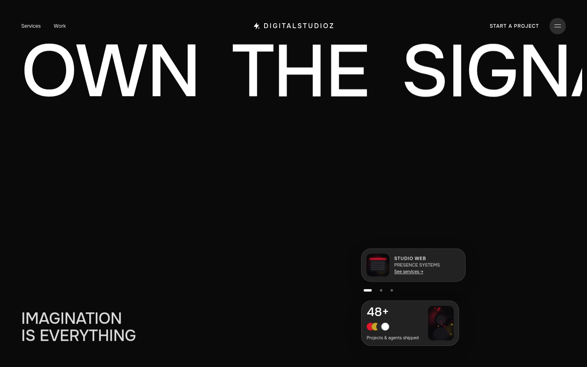

# DigitalStudioz Baseline Ravyn

> Ravyn redo of the full GetLayers **Baseline** prompt — same Lenis / spring / clip-mask bones, remapped from tennis to **DigitalStudioz** (charcoal · signal red · gold). Signal Desk is scrapped; this is the real Baseline structure.

[](https://agentzlab.github.io/DigitalStudioz-Baseline-Ravyn/)
[](https://github.com/agentzlab/DigitalStudioz-Baseline-Ravyn)
[](https://github.com/agentzlab/DigitalStudioz-Baseline-Ravyn)


**Live preview:** https://agentzlab.github.io/DigitalStudioz-Baseline-Ravyn/



## What's inside

- **Baseline bones** — Lenis smooth scroll, adaptive rem grid, spring helper, clip-mask word/line reveals, Inview, Hover (off ≤768), loader curtain, contact modal, fullscreen menu.
- **DigitalStudioz brand** — bolt + EQ motif, tagline *Imagination is everything.*, hero **Own The Signal**.
- **Services** — Websites & digital presence · Brand systems · AI workflows / agents · Care / business tech (IT spoke only).
- **Featured work** — LinkLabz + WorkshopLabz cards with live/GitHub links.
- **Demo stats + sample testimonials** — clearly labeled sample quotes.
- **Generated imagery** — charcoal/red/gold cinematic plates (no tennis GetLayers hotlinks, no flat gray placeholders).

## Design language

| Token | Value |
| ----- | ----- |
| Page frame | Charcoal `#0a0a0a` |
| Brand / signal | Red `#e1182e` / light `#ff4d5e` |
| Accent | Gold `#c9a227` |
| Surfaces | White / `#f4f4f4` light bands on dark frame |
| Type | Onest 400/500 |

Dark-mode first chrome; light editorial bands keep Baseline’s contrast rhythm.

## Tech stack

| Layer | Choice |
| ----- | ------ |
| Markup | Single `index.html` (no build step) |
| Motion | Lenis `1.1.18` via CDN importmap + rAF spring helper |
| Hosting | GitHub Pages from `main` (`.nojekyll`) |
| Assets | Generated WebP in `assets/` |

## Project structure

```text
dsz-baseline-ravyn/
├── index.html              # full Baseline-bones DigitalStudioz site
├── assets/
│   ├── hero/hero-studio.webp
│   ├── 1.webp … 5.webp     # portraits / collection / metric
│   ├── work-linklabz.webp
│   ├── work-workshoplabz.webp
│   ├── facilities-icon.webp
│   └── screenshot.png      # README hero shot
├── .nojekyll
└── README.md
```

## Workflow — branches, not overwrites

`main` mirrors the latest approved build. Cut changes as **new branches** off `main`. No PRs unless Jon asks. Do not silently replace `main`.

## Local preview

```bash
cd /workspace/dsz-baseline-ravyn
python3 -m http.server 8766
# open http://localhost:8766/
```

---

Ravyn · Baseline redo · 2026-09-26 · DigitalStudioz
